# Rétro-ingénierie : comment une histoire est organisée dans la Lunii (V2 et V3)

Ce document décrit le format des packs d'histoires des Lunii à stockage de masse (firmware **2.x** et **3.x**), tel qu'il a été relevé dans le code du driver Java STUdio (`FsStoryTellerAsyncDriver`, `CipherUtils`, `FsStoryPackReader`, `FsStoryPackWriter`) et reproduit dans [index.html](./index.html).

> **Légende de fiabilité :** les structures binaires, les offsets et les algorithmes viennent directement du code Java. Les interprétations du *comportement* de l'appareil (par exemple le rôle exact de `optionIndex`) sont signalées par la mention *(interprétation)*.

> **Nomenclature :** « V2 » et « V3 » désignent ici le firmware **2.x** et **3.x** (disposition `.md` / `.pi` / `.content`). Le firmware 1.x (accès USB brut via `libusb`) n'est pas traité.

---

## 1. Vue d'ensemble de la carte SD

Les firmwares 2.x et 3.x partagent **la même disposition**. Seuls le chiffrement et le contenu de `.md` diffèrent.

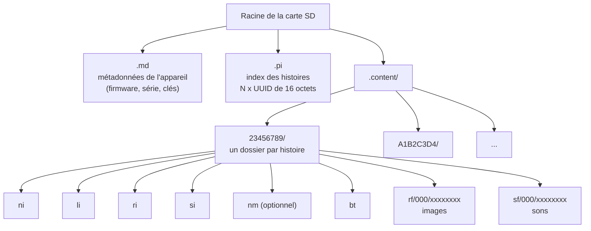

| Élément | Rôle |
|---|---|
| `.md` | Version du format, firmware, numéro de série, UUID ou clés de chiffrement de l'appareil. |
| `.pi` | **Seule source de vérité** de ce que la Lunii affiche, et dans quel ordre. Un dossier absent de `.pi` est ignoré. |
| `.content/<XXXXXXXX>/` | Fichiers d'une histoire. Le nom est composé des **8 derniers caractères hexadécimaux de l'UUID**, en majuscules. |

### 1.1 Lien entre l'UUID d'une histoire et son dossier

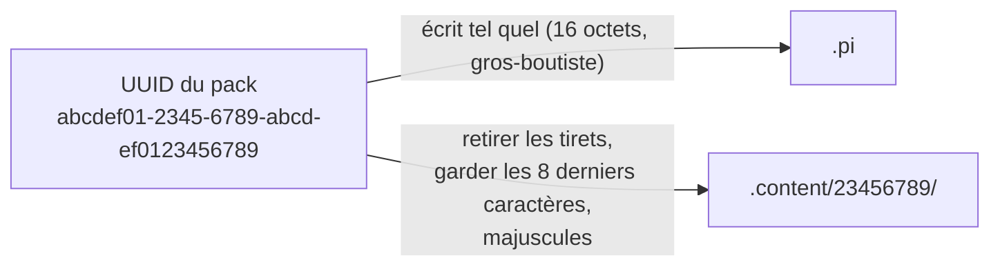

Conséquences :

- L'UUID complet n'existe **que** dans `.pi`. Le dossier ne contient aucun UUID : il est impossible de le retrouver depuis le contenu du dossier.
- Deux UUID dont les 8 derniers caractères sont identiques entrent en collision sur la carte.
- C'est pourquoi la bibliothèque PC nomme ses dossiers `<uuid complet>[.suffixe]`.

---

## 2. Le modèle logique : un graphe de nœuds

Une histoire est un **graphe orienté** composé de deux types de nœuds :

- **Nœud d'étape** (*stage node*) : un « écran » avec une image, un son et des règles de contrôle. C'est ce que l'enfant voit et entend.
- **Nœud d'action** (*action node*) : une **liste ordonnée d'options**, chacune pointant vers un nœud d'étape. C'est le menu dans lequel on tourne la molette.

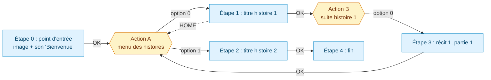

### 2.1 Ce que porte un nœud d'étape

| Champ | Description |
|---|---|
| Image | Index dans `ri`, ou `-1` pour aucune. |
| Son | Index dans `si`. Si le son manque, l'écriture insère un MP3 silencieux pour satisfaire l'appareil. |
| Transition OK | Triplet *(nœud d'action, nombre d'options, option sélectionnée)* ou « aucune ». |
| Transition HOME | Même structure, pour le bouton maison. |
| Contrôles | 5 booléens : `wheel`, `ok`, `home`, `pause`, `autoplay`. |

### 2.2 Ce que porte un nœud d'action

Un nœud d'action n'a **aucune existence propre** dans les fichiers. C'est une plage contiguë de `li` définie par *(position de départ, nombre d'options)*, que les nœuds d'étape portent dans leurs transitions.

### 2.3 Sémantique des contrôles *(interprétation)*

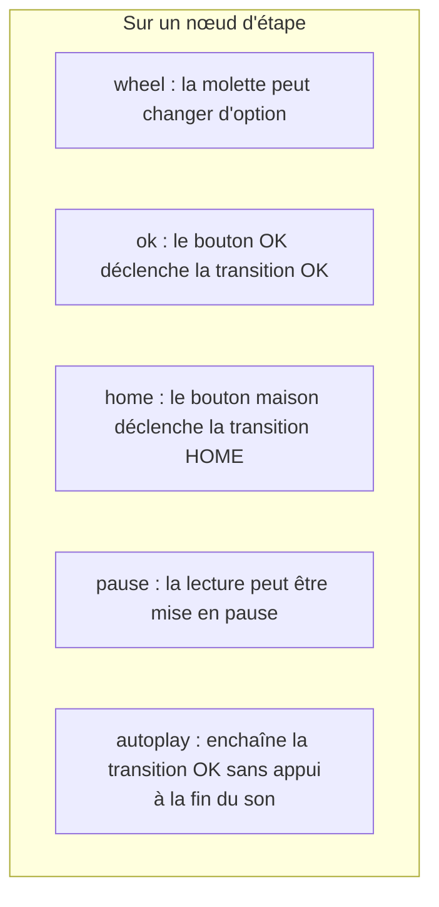

`optionIndex` désigne l'option du nœud d'action sur laquelle on atterrit, et le nombre d'options borne la molette.

---

## 3. Les fichiers d'un pack et leurs liens

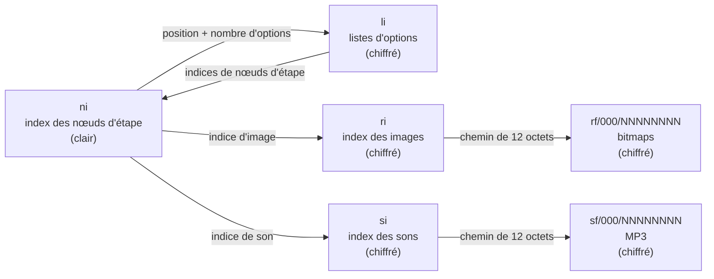

### 3.1 `ni` : index des nœuds d'étape (toujours en clair)

Little-endian. Un en-tête fixe de **512 octets**, suivi de N enregistrements de **44 octets**.

**En-tête :**

| Offset | Taille | Contenu |
|---|---|---|
| 0 | int16 | Version du format de `ni` (toujours `1`). |
| 2 | int16 | **Version du pack** (affichée par l'application). |
| 4 | int32 | Début de la liste des nœuds (`512`). |
| 8 | int32 | Taille d'un nœud (`44`). |
| 12 | int32 | Nombre de nœuds d'étape. |
| 16 | int32 | Nombre d'images distinctes (entrées de `ri`). |
| 20 | int32 | Nombre de sons distincts (entrées de `si`). |
| 24 | octet | « Pack d'usine » : `1` pour éviter l'inspection par l'application officielle. |
| 25 à 511 | | Zéros. |

**Enregistrement d'un nœud d'étape (44 octets) :**

| Offset | Taille | Champ |
|---|---|---|
| 0 | int32 | Indice de l'image dans `ri` (`-1` = aucune). |
| 4 | int32 | Indice du son dans `si`. |
| 8 | int32 | Transition OK : **position** de la liste dans `li`, en entrées de 4 octets (`-1` = aucune). |
| 12 | int32 | Transition OK : **nombre d'options**. |
| 16 | int32 | Transition OK : **option sélectionnée**. |
| 20 | int32 | Transition HOME : position dans `li`. |
| 24 | int32 | Transition HOME : nombre d'options. |
| 28 | int32 | Transition HOME : option sélectionnée. |
| 32 | int16 | `wheel` (0 ou 1). |
| 34 | int16 | `ok`. |
| 36 | int16 | `home`. |
| 38 | int16 | `pause`. |
| 40 | int16 | `autoplay`. |
| 42 | int16 | Zéro (alignement). |

Le **nœud d'étape n° 0 est le point d'entrée** de l'histoire.

### 3.2 `li` : listes d'options

Une suite d'`int32` little-endian. Chaque entrée est l'**indice d'un nœud d'étape** dans `ni`. Un nœud d'action occupe une plage contiguë de cette suite.

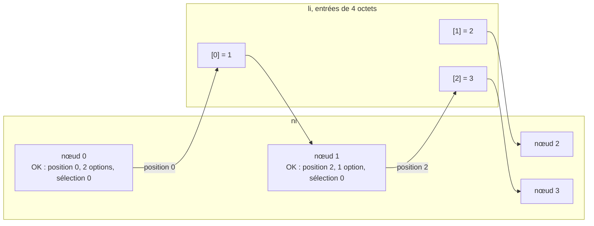

Règles relevées à l'écriture :

- Les nœuds d'action sont rangés dans `li` **dans l'ordre de première référence** en parcourant `ni` (transition OK, puis HOME).
- Un nœud d'action partagé par plusieurs transitions n'est écrit qu'**une seule fois** : les nœuds d'étape pointent alors vers la même position.

### 3.3 `ri` et `si` : index des ressources

Chaque entrée fait **12 octets** ASCII : `000\NNNNNNNN`, soit trois chiffres, une barre oblique inverse, puis un indice sur 8 chiffres.

| Entrée n° i | Fichier correspondant |
|---|---|
| `000\00000000` | `rf/000/00000000` (ou `sf/000/00000000`) |
| `000\00000001` | `rf/000/00000001` (ou `sf/000/00000001`) |

- Les ressources sont **dédoublonnées par empreinte SHA-1** : une image ou un son utilisé par dix nœuds n'est stocké qu'une fois.
- Les indices sont attribués dans l'ordre de première apparition en parcourant les nœuds. La couverture d'une histoire est donc `rf/000/00000000`.

### 3.4 Formats des ressources

| Ressource | Contrainte vérifiée à l'écriture |
|---|---|
| Image (`rf/`) | BMP **320 × 240**, **4 bits** par pixel (16 couleurs), compression **RLE4**. |
| Son (`sf/`) | **MP3 mono 44 100 Hz**, sans balise ID3 (v1 ou v2). |

### 3.5 Fichiers annexes

| Fichier | Chiffré | Rôle |
|---|---|---|
| `nm` | non | Fichier vide. Sa présence indique que le **mode nuit** est disponible. |
| `bt` | spécial | Jeton de démarrage propre à l'appareil, voir la partie 5. |
| `.cleartext` | non | **Bibliothèque PC uniquement.** Indique que les fichiers y sont en clair. Il n'est jamais copié sur la Lunii. |

---

## 4. Le fichier `.md` : identité de l'appareil

Les deux premiers octets (int16 little-endian) donnent la **version du format de `.md`**, qui détermine le firmware et la disposition.

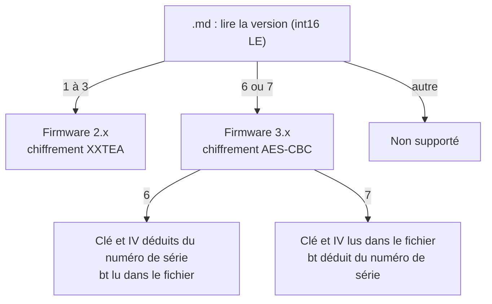

### 4.1 Version 1 à 3 (firmware 2.x)

| Offset | Taille | Contenu |
|---|---|---|
| 0 | int16 LE | Version du format. |
| 2 à 5 | 4 | Ignorés. |
| 6 | int16 LE | Firmware, partie majeure. |
| 8 | int16 LE | Firmware, partie mineure. |
| 10 | int64 BE | Numéro de série. `0`, `-1` et `0xFFFFFFFF00000000` signifient « absent ». Affiché sur 14 chiffres. |
| 18 à 255 | 238 | Ignorés. |
| **256** | **256** | **UUID de l'appareil** (256 octets), matière de la clé propre à l'appareil. |

### 4.2 Version 6 et 7 (firmware 3.x)

| Offset | Taille | Contenu |
|---|---|---|
| 0 | int16 LE | Version du format. |
| 2 | 1 | Firmware majeur, en **ASCII**. |
| 3 | 1 | Ignoré (le point). |
| 4 | 1 | Firmware mineur, en **ASCII**. |
| 5 à 25 | 21 | Ignorés. |
| 26 | 24 | **Numéro de série** (ASCII, 24 octets). |
| 50 à 63 | 14 | Ignorés. |
| 64 | 32 | **v6 :** fichier `bt` (32 octets). |
| 64 | 16 | **v7 :** clé AES. |
| 80 | 16 | **v7 :** vecteur d'initialisation (IV). |

Valeurs déduites du numéro de série `SN` (24 octets) :

| | Clé AES | IV | `bt` |
|---|---|---|---|
| **v6** | `SN[0..16]` | `SN[16..24]` suivi de `SN[0..8]` | lu à l'offset 64 |
| **v7** | lue à l'offset 64 | lu à l'offset 80 | `SN[0..24]` suivi de `SN[0..8]` |

---

## 5. Chiffrement : ce qui différencie V2 et V3

Dans les deux cas, **seuls les 512 premiers octets** de chaque fichier chiffré le sont. Le reste est écrit tel quel. Les fichiers `ni`, `nm` et `.cleartext` ne sont jamais chiffrés.

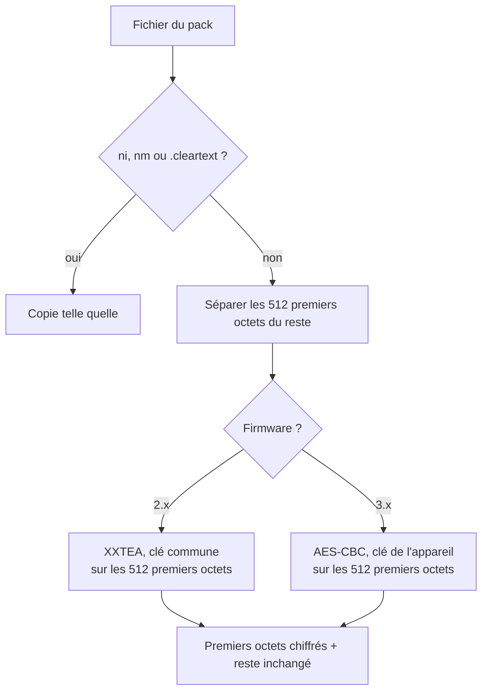

### 5.1 V2 : XXTEA avec clé commune

| Paramètre | Valeur |
|---|---|
| Algorithme | XXTEA (*btea*), delta `0x9e3779b9`, tours = `1 + 52 / n`. |
| Données | Mots de 32 bits **little-endian**, `n = min(128, taille / 4)` mots. |
| Clé commune | `91 bd 7a 0a a7 54 40 a9 bb d4 9d 6c e0 dc c0 e3`, lue en 4 mots **big-endian**. |
| Sens | `n > 1` chiffre, `n < -1` déchiffre. |

**Fichier `bt` (V2).** Il prouve que le pack a été préparé pour *cet* appareil.

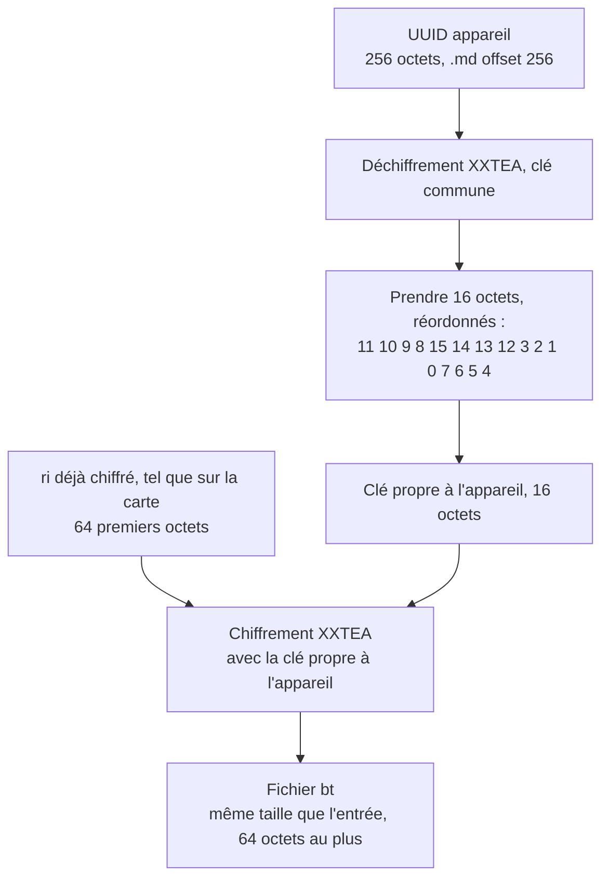

### 5.2 V3 : AES-CBC avec clé de l'appareil

| Paramètre | Valeur |
|---|---|
| Algorithme | AES-128 en mode CBC, **sans padding PKCS**. |
| Clé et IV | Ceux du `.md`, dont **chaque groupe de 4 octets est inversé** (conversion d'endianness 32 bits). |
| Bourrage | Si la taille n'est pas un multiple de 16, **zéros** ajoutés avant chiffrement. Le fichier chiffré est donc plus long. |
| `bt` | Les 32 octets issus du `.md`, copiés tels quels. |

Conséquence : un petit fichier V3 dont la taille n'est pas multiple de 16 (par exemple `li` ou `ri`) est **allongé de zéros** sur la Lunii. Au déchiffrement, ces zéros restent présents en fin de fichier.

### 5.3 Comparatif

| | **V2 (firmware 2.x)** | **V3 (firmware 3.x)** |
|---|---|---|
| Versions de `.md` | 1 à 3 | 6 et 7 |
| Disposition (`.md`, `.pi`, `.content`) | identique | identique |
| Algorithme | XXTEA | AES-128-CBC |
| Clé | Commune à toutes les Lunii | Propre à chaque appareil (dans `.md`) |
| Zone chiffrée | 512 premiers octets | 512 premiers octets |
| `bt` | Calculé : XXTEA de `ri` avec une clé dérivée de l'UUID appareil | Copié depuis ou dérivé de `.md` |
| Taille des fichiers | Conservée | Arrondie au multiple de 16 (si < 512 octets) |
| Packs de la bibliothèque PC | En clair (`.cleartext`) | En clair (`.cleartext`) |

---

## 6. Cycle de vie : installer, sauvegarder, supprimer

### 6.1 Installer un pack (PC vers Lunii)

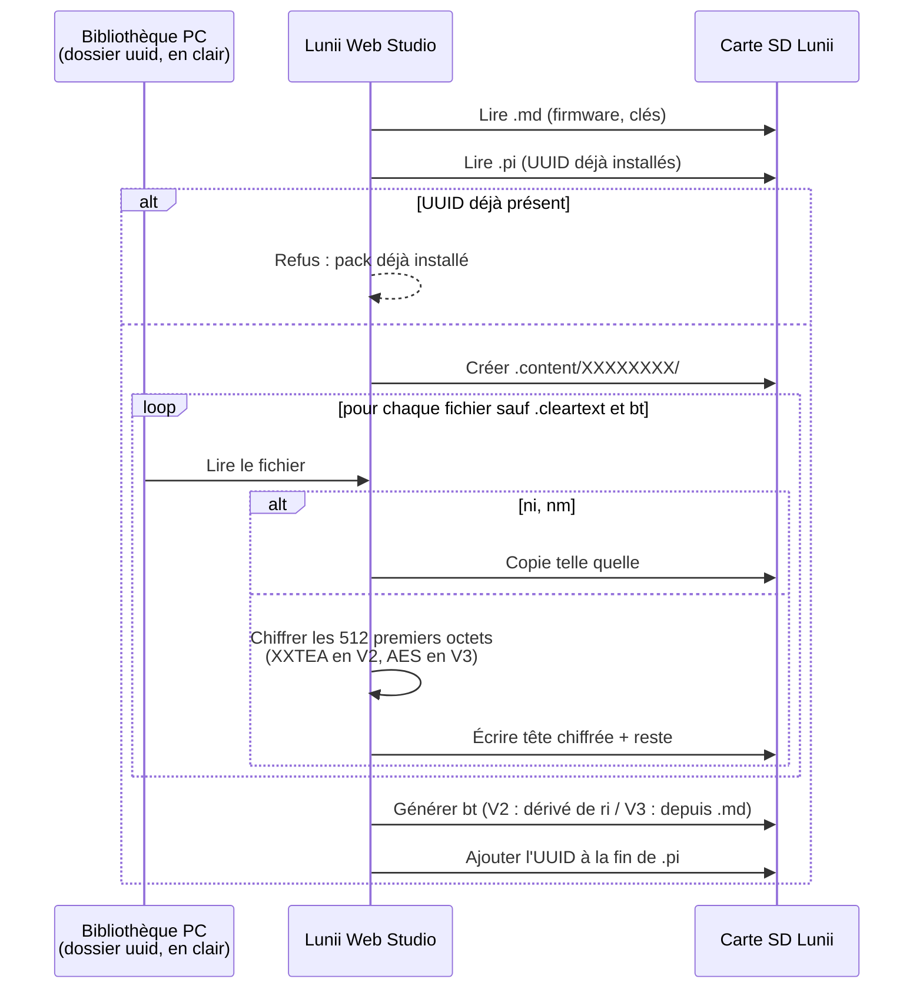

L'UUID n'est ajouté à `.pi` **qu'en dernier** : une copie interrompue laisse donc un dossier orphelin, jamais une histoire corrompue affichée.

### 6.2 Sauvegarder un pack (Lunii vers PC)

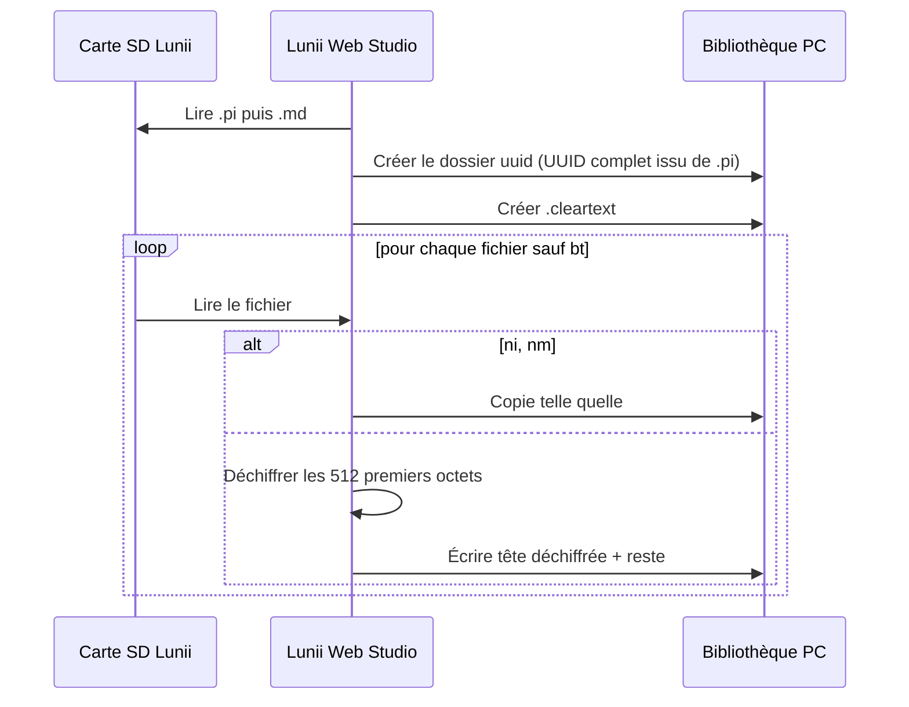

### 6.3 Désinstaller et réordonner

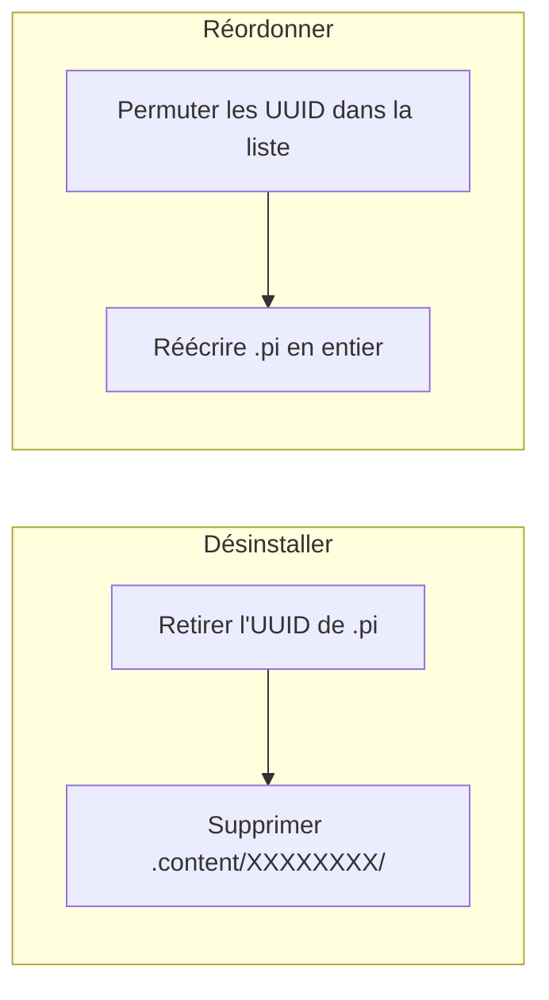

- Réordonner ne touche **qu'à `.pi`** : l'ordre d'affichage est l'ordre des UUID dans ce fichier.
- Le driver Java remplace `.pi` via un fichier temporaire `.pi.new`, car un fichier caché ne peut pas toujours être modifié en place sous Windows.

---

## 7. Formats de bibliothèque côté PC

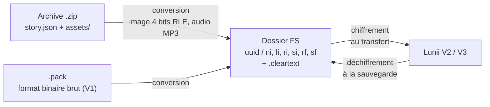

Une archive `.zip` décrit le même graphe en JSON (`story.json`) :

| Clé | Contenu |
|---|---|
| `version`, `title`, `description`, `nightModeAvailable` | Métadonnées du pack. |
| `stageNodes[]` | `uuid`, `squareOne` (point d'entrée), `image`, `audio` (noms dans `assets/`), `okTransition` et `homeTransition` (`actionNode`, `optionIndex`), `controlSettings` (`wheel`, `ok`, `home`, `pause`, `autoplay`). |
| `actionNodes[]` | `id` et `options[]` (liste d'UUID de nœuds d'étape). |

### 7.1 Règles de conversion `.zip` vers dossier FS

L'application web reproduit la conversion du Java (`ArchiveStoryPackReader`, `PackAssetsCompression.withPreparedAssetsFirmware2dot4`, `FsStoryPackWriter`) :

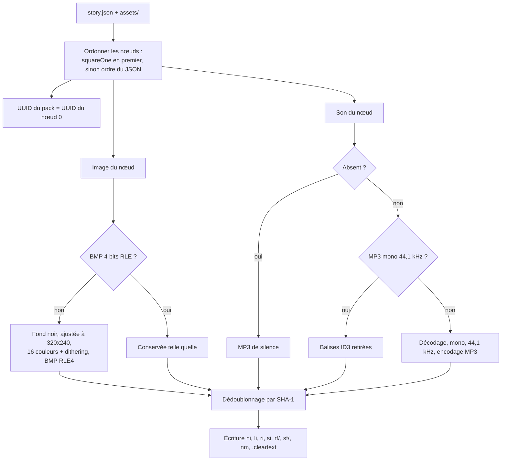

Points propres à l'implémentation web :

- Une image qui n'est pas en 320×240 est ajustée avec des bandes noires, alors que le Java la refuse.
- Le nombre de sons annoncé dans `ni` compte le silence inséré, alors que le Java ne compte que les sons explicites.
- Le silence est composé de 8 trames MPEG-1 Layer III à contenu nul (environ 0,2 s).
- La palette est calculée par coupe médiane, alors que le Java utilise un quantificateur à octree. Le résultat est équivalent mais pas identique octet pour octet.

---

## 8. Exemple minimal, de bout en bout

Une histoire à un seul choix : un accueil, deux titres, deux récits.

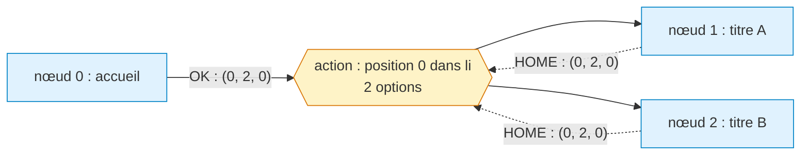

Contenu correspondant :

| Fichier | Contenu |
|---|---|
| `ni` | En-tête 512 octets (3 nœuds), puis 3 × 44 octets. |
| `li` | `01 00 00 00` `02 00 00 00` : l'action contient les nœuds 1 et 2. |
| `ri` | Une entrée par image distincte, par exemple `000\00000000`. |
| `si` | Une entrée par son distinct. |
| `bt` | Jeton propre à l'appareil. |
| `.pi` (racine) | L'UUID de l'histoire, 16 octets. |

---

## 9. Points d'attention pour le développement

- **Un seul fichier à tenir cohérent :** `.pi`. Tout ce qui n'y figure pas n'existe pas pour la Lunii.
- **Ordre d'écriture :** copier les fichiers, générer `bt`, puis seulement écrire `.pi`.
- **V3 et fichiers courts :** la taille change au chiffrement, ne jamais supposer qu'elle est conservée.
- **Espace disque :** l'API File System Access ne donne pas l'espace libre de la carte. Une carte pleine se manifeste par une erreur d'écriture.
- **Packs historiques chiffrés pour V2 :** sans `.cleartext` ni `ri` commençant par `000\`, le Java les considère déjà chiffrés. Il les recopie tels quels vers une V2 et les déchiffre d'abord vers une V3.
- **Zones non élucidées :** la signification des octets ignorés de `.md` (offsets 2 à 5 en v1 à 3, 5 à 25 et 50 à 63 en v6 et v7) n'est pas exploitée par le Java, donc non documentée ici.
